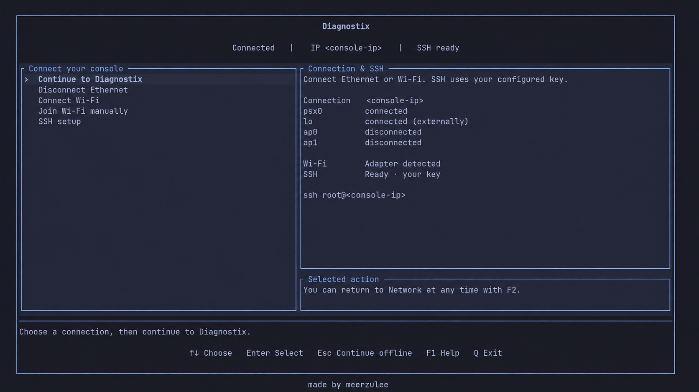
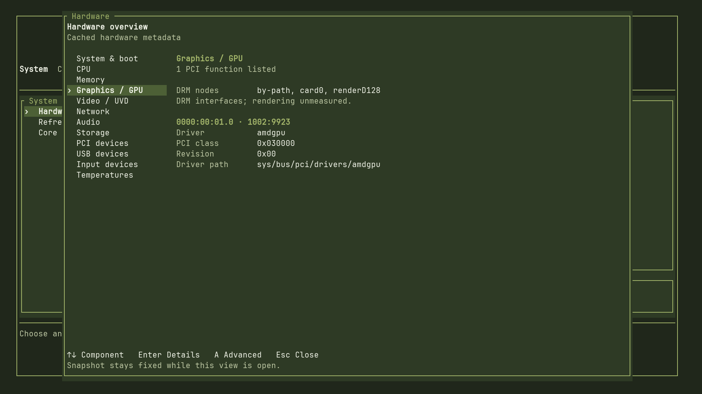

<div align="center">
  <h1>Linux psX</h1>
  <p><strong>Linux kernels for PlayStation 4 and PlayStation 5, with PS4 graphics drivers and diagnostics.</strong></p>
  <p>
    <a href="https://github.com/meerzulee/linux-psx/releases/tag/v7.2.11-psx-ps4-baikal-beta2">PS4 Baikal beta2</a>
    &middot; <a href="#diagnostix">Diagnostix</a>
    &middot; <a href="docs/BUILDING.md">Build</a>
    &middot; <a href="https://github.com/meerzulee/linux-psx/wiki">Wiki</a>
    &middot; <a href="https://github.com/meerzulee/linux-psx/issues">Issues</a>
  </p>
</div>

Kernel patches, configs, matching modules, PS4 Mesa and hardware evidence.
Distribution and desktop integration: [Omarchy psX](https://github.com/meerzulee/omarchy-psx).

## PlayStation 4

**Linux 7.2.11 · Baikal B1 · one locally tested PS4 Slim.** Results belong to
individual recorded builds; fresh builds and other consoles need their own tests.

✅ Observed working · 🧪 Experimental / partial · ⏳ Untested / unqualified

| Feature | Baikal B1 | Aeolia | Belize |
| --- | --- | --- | --- |
| Linux 7.2 | ✅ Booted, including local UVD dev6 | ⏳ | ⏳ |
| OpenGL / display | ✅ Liverpool, 4.6, 1080p60 | ⏳ | ⏳ |
| Vulkan / Mesa candidate | 🧪 Reference pixels and dev5 tests | ⏳ | ⏳ |
| UVD / H.264 decode | 🧪 1080p, 900-frame reference match | ⏳ | ⏳ |
| VCE encoding | ⏳ | ⏳ | ⏳ |
| Ethernet | 🧪 DHCP / verified SSH transfers; endurance pending | ⏳ | ⏳ |
| External USB root | ✅ Read/write boot | ⏳ | ⏳ |
| Internal SATA | 🧪 71 MB/s read benchmark; writes unqualified | ⏳ | ⏳ |
| Wi-Fi / Bluetooth audio | ✅ Reported with external firmware | ⏳ | ⏳ |
| HDMI audio | 🧪 44.1 kHz command; audible check deferred; 48 kHz open | ⏳ | ⏳ |
| Temperature / fan | 🧪 Historical temperature readings; fan unqualified | ⏳ | ⏳ |
| Blu-ray / optical | 🧪 Device detected | ⏳ | ⏳ |
| Power | ✅ Shutdown / normal restart with UVD; ~1.1 s to ICC on dev5 | ⏳ | ⏳ |

Power results: one corrected-image restart and one shutdown on this Slim;
the new immediate Power path still needs its own hardware check.
Ethernet: 20 SSH logins and verified 4 MiB transfers each way passed after
reconnecting the laptop's Wi-Fi; the precise LAN fault remains unresolved.

[Hardware evidence](diagnostics/SESSIONS.md) ·
[Remaining tests](docs/CURRENT-FINISH-PLAN.md) ·
[Ethernet](docs/ETHERNET.md) · [Mesa / Vulkan](docs/MESA-TESTING.md) ·
[UVD](docs/UVD.md) · [Internal storage](platforms/ps4/docs/INTERNAL-STORAGE.md)

## Storage comparison

Example manufacturer peaks, **read / write in MB/s**; these are not PS4 benchmarks.

| Storage example | Rated speed | PS4 link ceiling, before protocol overhead |
| --- | ---: | --- |
| SATA SSD — Samsung 870 EVO | **560 / 530** | **150 MB/s** with the current 1.5 Gb/s profile |
| 2.5″ HDD — BarraCuda Pro, 7,200 RPM | **Up to 160** data transfer | **150 MB/s** with the current profile |
| USB SSD — Samsung T9 4 TB | **2,000 / 2,000** | **500 MB/s** on a 5 Gb/s USB link |
| 128 GB USB flash — original Kingston Kyson | **200 / 60** | **500 MB/s** USB ceiling; drive performance differs |

**Measured reads on our PS4:** diagnostic USB **106 MB/s**, internal HDD
**71 MB/s**; small random reads **1,380 / 105 IOPS**.
[Read-only benchmark and scope](docs/PS4-STORAGE-COMPARISON.md#current-read-benchmark-2026-11-06).

[Specifications, actual results and benchmark plan →](docs/PS4-STORAGE-COMPARISON.md)

## Diagnostix

A lightweight USB diagnostic system with a **1 GiB core boot-set cap**:
network and SSH setup, readable hardware details, grouped reports, themes and
font settings. A quick hardware Overview leads to the advanced tabbed tests. Selected tests cover CPU/RAM, networking, X11/Wayland,
OpenGL/Vulkan, Firefox/Chromium and experimental UVD.

<p align="center">
  <a href="docs/images/diagnostix-network.png"></a>
  <a href="docs/images/diagnostix-hardware.png"></a>
</p>

Network setup and GPU inventory. [Capture and privacy-edit notes](docs/images/README.md).

[Download the experimental firmware-free kit](https://github.com/meerzulee/linux-psx/releases/tag/diagnostix-alpha7-20261107) ·
[Local firmware setup](docs/DIAGNOSTIX-RELEASE.md) ·
[Image and setup guide](docs/DIAGNOSTICS.md) ·
[Source](diagnostics/) · [TUI](diagnostics/ps4/tui/) ·
[Test scenarios](docs/PS4-DIAGNOSTIC-ALPHA.md) ·
[SSH setup](docs/PS4-DIAGNOSTIC-SSH-ACCESS.md)

## Build and boot

```sh
git clone https://github.com/meerzulee/linux-psx.git
cd linux-psx
make check
make TARGET=7.2-ps4-baikal-native-dev
```

The example builds the ordinary native-Ethernet target on Linux x86-64.
[Build prerequisites and macOS cross-builds](docs/BUILDING.md) ·
[Booting](docs/BOOTING.md) · [Boot arguments](docs/PS4-BOOTARGS.md) ·
[Separate UVD builds](docs/UVD.md) · [7.2 port](docs/PORT-7.2.md) ·
[6.18 history](docs/LINUX-6.18.md).

Keep each kernel with its **whole matching modules**. Loader, initramfs,
root filesystem and device firmware are separate inputs; firmware is not bundled.
[Artifact contract](docs/ARTIFACTS.md).

## PlayStation 5

Separate development candidate; no local hardware acceptance.
[Source and build notes →](docs/PS5.md)

## Contributing

[Contribution guide](CONTRIBUTING.md) · [Credits and sources](CREDITS.md).
Thanks to [suds-mcduff](https://github.com/suds-mcduff) for the PS4 HDMI
underscan and Baikal ICC power-off contributions.

Independent community project, unaffiliated with Sony Interactive Entertainment.
Existing authorship and per-file licenses apply.
