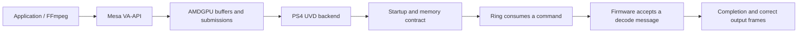

# Current normal UVD runtime plan — 2026-10-20

EXP-20261020-005 recovered one real 64×64 H.264 frame with every visible
NV12 byte matching an independently software-decoded reference. Its frozen
kernel was a boot-only caller. It does not qualify the normal driver below.
The historical notes after the separator retain their original dates/scope.

The current normal driver is `experiments/ps4-uvd-driver/runtime/`.
Source attempt-06 passes a native full kernel/modules link, targeted Mac/native
source checks, private packaging and scoped compiled review. EXP-20261020-006
then booted to desktop/SSH and passed one forced-VAAPI run with all 120 distinct
128×96 H.264 I/P frames byte-exact. See the runtime RESULTS.md for pinned artifacts
and limits. This is the first normal application result, not repeatability.
The owner selected UVD first, Mesa ownership/upgrades next, then VCE.

```text
verified fixed picture
    → normal driver integration + native build (passed)
    → package and install a complete matching USB boot set (passed)
    → owner cold boot: queue initialization + desktop/SSH (passed once)
    → forced FFmpeg/VAAPI: exact 120-frame NV12 comparison (passed once)
    → visible mpv playback, seeking and repeated runs (next)
    → cold-boot repetition and broader H.264 coverage
    → separately qualify the experimental driver
    → Mesa baseline, updates/tuning, then VCE
```

EXP-20261020-006 changed from the fixed-picture boot caller to the normal UVD
queue, grouping authorized USB installation, one owner launch and one application
decode in a completed bounded UART session. The next experiment adds visible
mpv presentation to this same healthy boot. Declare exact inputs, evidence,
deadline and rollback before new submissions. Retain the known preparation boot
set and all previous module trees. The runtime is default-off, Liverpool
only, one active AVC handle; it blocks reset/PM/removal/shutdown cleanup
once entered. Recovery is a full power-off, with no retry or rearm.

First application acceptance requires one completed uninterrupted UART
session, the exact candidate banner/installed identity, a live normal
userspace endpoint, a real forced-VAAPI decode of the pinned 120-frame
I/P fixture, equality of every downloaded NV12 byte, and no captured
fault/reset/queue-closure violation. Compile/host/mock checks cannot meet
these criteria. A single pass is first application evidence only.

Promotion to a repeatable experimental AVC result requires at least three
cold boots of the same frozen artifact set, successful exact fixture runs
on each, and separate visible playback/seek/repeat checks with broader
H.264 samples. Other codecs, encoding, PM and teardown stay unqualified
until their own implementation and real-hardware criteria are met.
No public push or release is authorized by this plan.

---

# PS4 UVD: plan from command execution back to startup

Updated: 2026-10-20. Scope: PS4 Slim / Baikal B1 / Orbis 12.02 and
the private Linux 7.2.11 UVD diagnostic. EXP-20261019-001 completed one
readiness-policy test. EXP-20261019-002 demonstrated one context-token command,
and EXP-20261019-003 completed one CPU-observed memory writeback.
EXP-20261019-004 timed out without observing its IB-only token. EXP005
stopped on its STATUS guard despite printed fresh markers. The subsequent
EXP-20261020-001 completed its bounded status observation with persistent
bit16 and fresh main-ring markers. EXP-20261020-002 subsequently completed
one qualified IB-only DATA0 marker observation. Decoder support remains unproved.

## Current development decision

Latest implementation status (2026-10-20): the new CREATE-controller task
received an automatic review stop, stated as "possible cybersecurity risk".
Its Mac host fixture passed 124 cases and 8 exact injected defects; a native
fixture invocation failed during compilation before running cases. These are
separate events. The implementation, cancelled independent code review and
dependent build/packaging work remain stopped; no new image is ready.
`lab/uvd-2026-10-20/message-create/STOP-STATUS.json` preserves the exact state.
The owner's separate request for independent opinions on completed evidence
and overall architecture is active with Claude and oc2. The owner also wants
encoding, which has no hardware acceptance evidence. Existing results below
retain their original scope.

EXP-20261020-001 has completed UART continuity and result
`STOBS_BIT16_PERSISTENT error=0 PARKED`: 39 sequential records, each with
DATA0 `55564435`, CONTEXT_ID `43545835` and raw RPTR/WPTR16. The first record
contained STATUS3; the remaining records and terminal core contained
STATUS10002. There were no observed value regressions; the endpoint indexed
sweep passed. Deadline-first completion before record40 was predeclared.
This is a scoped observation, not hardware acceptance or an explanation of
bit16. It does not change EXP005's failed verdict. The completed result is
`lab/uvd-2026-10-19/status-observation/handoff/runtime/RESULT.json`.

The owner requested retaining the development USB image and continuing
custom-driver development. EXP-20261020-001 through EXP-20261020-003 are closed.
EXP003 reached normal Linux and exposed the cached preparation report over
SSH. Linux remains running for development. Its frozen result is
`UART_OBSERVATION_INCOMPLETE` because the UART parser misclassifies the
initramfs command-line echo. A separately reviewed correction passes the
original24 and new22 tests on both hosts. Supplemental saved-input analysis
matches UART, cached state, current-boot journal and normal userspace.
The original result and predeclared tool bytes remain unchanged; the access
setup also exceeded its original five-minute budget.

EXP-20261020-002 completed one operator launch. Its candidate places a fresh
DATA0 marker only in the owned IB, retaining EXP004's UVD5-style address/length
prefix. The packet builder, kernel adapter and actual-source host checks are
complete: 156 cases in optimized and sanitizer modes on both hosts, with eight
injected defects detected by named witnesses. Native build/package, scoped
compiled review and host staging passed. CPU or main-ring writes of that fresh
value are excluded from the attribution contract. No firmware message or fence
is part of this step. The source-bound saved result has
`qualified_marker_observation=true`:40 consecutive complete valid samples
contained the IB-only DATA0 value with RPTR/WPTR16. All ends were before
250ms, final direct/sweep checks passed, and one publication was recorded.
Completed UART continuity has no errors; the result SHA256 is
`2b7ffc6300897ba7c5cdddbd4e249e17fbd705d3300ebbbe19832f5b1a62af30`
under `ib-data/handoff/revision-2/runtime/RESULT.json`.
This establishes one scoped IB command observation, not general translation,
coherence, firmware-message compatibility or a decoded frame.

The candidate release is `7.2.11-psx-ps4-baikal-uvd-ib-data-dev1`, kernel
SHA256 `463eae4c081a616714a75a0dc9daf5713828462833af937214126073ea0094fc`.
It requires two consecutive valid joint marker/pointer observations ending
strictly before 250 ms, with one publication and at most 40 records. All
outcomes park. Installation, matching module readback and pre/post filesystem
checks passed; both USB partitions were unmounted. Revision 2 of the host
installer records console power as unobserved and requires the detached USB
on the host with launch held. A fresh test still requires a full power-off
since the previous parked Linux run. Continuous UART remains on its existing
generation; EXP002 closed at raw offset1,887,219 with234,648bounded bytes.
Private status, installation and plan pins are in
`lab/uvd-2026-10-20/ib-data/PROGRESS.json` and `handoff/revision-2/`.

Offline development proceeds in parallel. The preparation-only candidate
under `experiments/ps4-uvd-live-prepare/` retains the full owned mapping after
the existing SDMA proof, exposes cached per-device status and continues normal
initialization without UVD setup. Attempt 05 fixes a late PCI probe cleanup
gap. Its 77 extracted-source cases pass in optimized and ASan/UBSan builds on
both hosts; all 13 injected defects fail at their intended named witnesses.
Primary source review is complete. Claude's separate PCI/DRM cleanup review
found no must-fix in the three new probe blocks; teardown-state and coverage
qualifications are recorded alongside it. The first full native compilation
exposed a missing DRM declaration header in debugfs. Attempt 06 adds only
that include and passes the host checks on both machines. Native02 completed
a full clean build and private packaging, including 41 matching modules and
corresponding source. Primary's scoped compiled review passed; Claude's
separate compiled PCI/debugfs review found no must-fix. The compiled checks
cover the preparation success return, ownership predicates, cached status,
invalidation wiring and completed-owner cleanup. The failed first build and
unchanged baseline are preserved. Release
`7.2.11-psx-ps4-baikal-uvd-live-prepare-dev1` has kernel SHA256
`e7abc9a8f4c5d4d19ce12dbab2df9f113a137c61f67497ab5c00ccb31a74cb4f`;
the review is `lab/uvd-2026-10-20/live-prepare/compiled-audit/compiled-review.json`.
This preparation image was booted once in EXP-20261020-003. UART reported
PREPARED at 8.300 seconds and graphical userspace at 17.826 seconds. One SSH
capture read cached PREPARED with matching proof/observed generation 1,
VMID4 reservation and the expected CRC. The cached state is historical,
not a fresh hardware mapping sample. No UVD arm or decoding was performed.
The frozen binder stopped on `MALFORMED_CMDLINE` at the known initramfs echo,
line1894. Its original result SHA256 is
`4ead4ef079aa6148a124b4b092d60af3d09399e6ac0cca05d201533c062ea92e`.
The isolated parser revision and post-hardware supplement remain separate
from that verdict. Supplemental result `1b78a5e3…` records the later
journal/clock/PID1/userspace comparisons, all matched against the saved bytes.
SSH/access setup exceeded the original five-minute
budget while the owner supplied the endpoint and requested persistent sudo.
These observations are not a claim that the entire predeclared procedure passed.
Static initramfs/argument compatibility has been checked. The retained C
initramfs is kept, and an offline host bundle has been assembled from the
actual reviewed kernel, config and complete matching modules. A saved-status
evaluator passes 35 tests / 194 cases on each host; it rejects PREPARED with
zero generation because the reviewed path first records GART_ENABLE. The
offline bundle tool passes 30 tests. Acquisition, saved-capture replay,
UART/cache comparison and stage/transaction checks also pass on both hosts.
The transaction validator passes against the actual native bundle and prior
IB installation evidence. The boot-ID/journal collector passes 32 fake tests
on each host, and the saved final-result binder passes 42 synthetic tests on
each host. Review corrected recognition of the retained rootfs's systemd
messages, userspace milestone ordering and installation-state validation.
The host SSH receipt writer passes 43 fake tests on each host and is reviewed;
the seven-tool observation contract is frozen as data only. None establishes
hardware acceptance. The later experiment ID, actual stage and final operator
review now exist for EXP003 after conclusion of EXP002. The preparation image
itself is unchanged; runtime evidence is preserved in that experiment's
`runtime/` directory. The bounded UART session has completed continuity.
The actual config defaults debugfs access off; this later boot therefore
needs `debugfs=on` alongside the preparation gate to create its cached status
interface. This is a recorded boot-policy prerequisite, not a kernel rebuild.

A separate passive fault-history candidate now fills an observation gap for
future live development. The existing GMC handler acknowledges fault registers
before a later worker can read them. `experiments/ps4-uvd-vmid4-fault/` retains
its already-captured tuples under a dedicated lock. Revision2 maintains a
total plus 16 captured-STATUS VMID categories and one literal all-ones-status
category, each with first/last records and saturating counts. Existing IH
telemetry and GMC MMIO order are preserved. Patch `d2360ccb…` passes 47
actual-source cases in optimized and ASan/UBSan modes on both hosts, plus
10 exact-witness injected defects. Both changed kernel translation units
compile with the native flags and pass objtool in an isolated overlay.
Primary revision2 review and required repository checks pass. No linked
kernel, live consumer, arm endpoint or hardware result exists for this patch.
The enlarged embedded observer requires a full rebuild before future linking.
The running preparation image does not contain this revision.

Independent review then surfaced a concrete coverage limitation: saved
EXP-20261018-007 reports captured VMID14 faults during its UVD window, which
the VMID4-only filter would discard. Primary verified the saved raw tuple.
A separate revision now retains total and per-VMID captured history, with
a distinct literal all-ones-status category. Attempt01's scoped passes remain
preserved. Revision2 software accounting is reviewed; its future live consumer
remains unimplemented. See `vmid4-fault/REVIEW-DISPOSITION-REV1.md` and
`vmid4-fault/PRIMARY-REVIEW-REV2.md`.

Future live readiness still needs a lifecycle contract. Native source confirms
that generic teardown can unpopulate pinned BO backing; retaining an owner
pointer alone does not retain its pages. Selected original stop code contains
two required status predicates, one non-gating poll, and reset-related stores
under public UVD5 naming. These are static candidate observations, not a
qualified Linux stop/drain sequence. Its poll budgets are iteration counts;
wall time and complete transitive teardown ordering remain unproved.
Private dispositions are `live-ready-design/PRIMARY-DISPOSITION.md`,
`vmid4-fault/PRIMARY-REVIEW.md` and
`lab/2026-10-20-uvd-kernel-83/selected-stop-contract/PRIMARY-REVIEW.md`.

The returning readiness backend is now implemented with per-device
operation/result state and the preserved legacy boot wrapper. Its 72
actual-source cases pass in optimized and ASan/UBSan modes on both hosts;
nine injected defects are detected at their expected witnesses. The isolated
native readiness object compiles and passes objtool. Primary review found
no must-fix within this refactor's scope. Its patch is `e0443efc…`; see
`lab/uvd-2026-10-20/ready-core/PRIMARY-REVIEW.md`.

Fault-history revision2 and the readiness refactor have also been composed
over their matching preparation baseline: 18 files, six changed files,
exact ordered patch replay. This source candidate is not a combined build.
Claude's separate software control-state helper is now implemented and
primary-reviewed:70 cases in optimized and ASan/UBSan modes on both hosts,
14 exact-witness defects detected, and a real kernel object/objtool pass.
Its first object check stopped after successful compilation because the
dependency inventory omitted generated `autoconf.h`; a separately verified
configuration pin corrected the checker without changing the helper.
A public CREATE/DESTROY serializer also passes primary review,33 cases in
both modes and5 exact mutants on both hosts. Both components are unwired.
No firmware-message acceptance follows from their software checks.
The boot-only wrapper still parks and excludes normal
initialized producers; dropping those checks would not create a live-driver
contract. Development continues while the PS4 remains running.
No live caller or write endpoint is part of the readiness refactor.
`live-ready-design/LIVE-DEVELOPMENT-SEAM.md` records exact source/export and
lifecycle findings. A module broker is optional later work, not a reason for
another data-only hardware boot.

Oc2 recovered four static kernel-function dossiers from the owner's research
host. Primary assembly checks confirm a wrapper selecting the UVD5-style
LOW/HIGH pair and common 64-DWORD packet construction in one dispatch branch.
Both packet-copy destinations derive from the same context field; the
embedded indirect address derives from a different field. Further assembly
work traced the constructor's selector to cached CPUID leaf 1 EAX. The saved
console signature `00710fa0` maps to selector 1. Primary compared all 665
ordered instructions and relative body ranges of that encoder against the
previously inspected default branch. The only differences after normalizing
local code addresses are three references to distinct copies of the same
`copyin` string; their literal ELF bytes were verified equal. Packet
construction, IB register selection and index updates otherwise match in
the saved listings. Context initialization remains a separate question.
This is an expected branch from static code and saved identity, not a traced
runtime dispatch or whole-program equivalence.
It is not a complete firmware ABI or proof that a 16-DWORD submission is
invalid; the installed experiment and its criteria remain unchanged.
The CPUID chain is in
`lab/uvd-driver-goal-2026-10-20/KERNEL-SELECTOR-CPUID-RESOLUTION.md`.
Packet evidence and draft corrections are in
`lab/uvd-driver-goal-2026-10-20/KERNEL-ENCODER-PRIMARY-CHECK.md`.
The reproducible selector comparison is
`lab/uvd-driver-goal-2026-10-20/SELECTOR1-DEFAULT-STRING-RESOLVED-COMPARISON.json`.
The selected startup initializes both index/capacity pairs to 0/0x400.
Further open/map tracing distinguishes firmware-copy backing at context+0x60
from packet backing at +0x80 and establishes the successful +0x88 mapping
value as `0x3001e0000`. Its consumers identify the internal ring base and
inner-packet window. The three internal mappings end at `0x300308000`;
the ioctl returns this separate boundary, not the ring-base context field.
Linux explicitly programs its separately owned ring at that latter address.
Numerical equality with the ioctl output therefore is not an Orbis ring
placement precedent. The difference does not diagnose the IB timeout or
justify altering the installed experiment. Details and REA evidence are in
`lab/uvd-driver-goal-2026-10-20/KERNEL-OPEN-MAP-PRIMARY-CHECK.md`.
Saved proxy evidence now connects the queried window to one 0xc000-byte
allocation/mapping request with returned-address equality, scratch pointers
at base/base+0x800 and a progress word at base+0x4000. The latter becomes
`0x30030c000`, matching the kernel descriptor bounds. These are separate
caller buffers, not the internal ring. The exact GPU mapping attributes,
progress writer and runtime branch remain unknown. The reconciled evidence
is under `lab/2026-10-20-uvd-kernel-83/caller-window/`. Byte inspection also
connects the three inspected device functions to the registered table at
`0xffffffff83ce18a0`; `0xffffffff82a3f0e0` is the `uvd` name string, followed
by a source-path string. This resolves table identity without assuming the
layout of adjacent objects or claiming runtime execution.

A [first-decode reference generator](../experiments/ps4-uvd-decode-fixtures/README.md)
now provides one synthetic 64×64 H.264 Baseline IDR frame and verified software
YUV/NV12 reference pixels. This is a future comparison asset; no PS4 decoding
or hardware output-layout conversion has been demonstrated.

Public-source research also clarifies that `amdgpu_uvd_send_msg` builds its
16-DWORD payload in an IB; its “direct” branch still emits that IB, merely
skipping the software scheduler. UVD4.2's legacy BASE/SIZE emitter differs
from UVD5's LOW/HIGH/SIZE emitter; importantly its BASE offset is the guarded
IB requester-ID register in the current map. It cannot be substituted into
this setup. Neither generation is established as a complete Liverpool
specification. Private research and source references are
in `lab/uvd-driver-goal-2026-10-20/public-path/FINDINGS.md`.

A usable custom backend also needs coherent address translation, firmware
message/session compatibility, actual completion fences and lifecycle
ownership. The stock UVD parser rewrites BO addresses and clears `job->vm`;
the probe's private VMID4 mapping cannot be assumed compatible. The concrete
kernel/userspace seams are recorded in
`lab/uvd-driver-goal-2026-10-20/USERSPACE-CONTRACT.md`.

The subsequent message-contract comparison pins the distribution's observed
Mesa 26.1.7 baseline and measures the public 3556-byte UVD message layout on
both hosts. It also corrects the next-session sequencing: the pinned upstream
self-test waits for CREATE completion before DESTROY, with a fence per phase.
Saved PS4 ioctl wrappers do not yet establish the firmware-message ABI.
Legacy Mesa profile advertisement and the UVD firmware-version query need
attention before exposing a limited experimental decoder through VA-API.
Full evidence: `lab/uvd-driver-goal-2026-10-20/message-contract/FINDINGS.md`.

The most useful direction is a **PS4-specific UVD backend within AMDGPU**,
developed around a small positive command-execution test. First establish
the console's startup, command and completion contracts. Treat CPU-write
tracing as a conditional diagnostic, rather than the automatic next build.

The owner's [dynamic RAM and VRAM proposal](PS4-DYNAMIC-MEMORY.md) is a
separate memory-management research direction. It does not change the active
UVD experiment or its boot memory layout.

## Completed readiness and command tests

The first candidate is a narrow [readiness observation policy](../experiments/ps4-uvd-ready-policy/README.md),
release `7.2.11-psx-ps4-baikal-uvd-poll-dev1`. It preserves the exact dev4
startup writes, clocks, external firmware, owned mappings, inhibited ring
fetch, zero pointers, passive observer and permanent retention. Only the
post-release predicate changes when `amdgpu.ps4_uvd_poll_state=1` is supplied:
admit raw MASTINT 0/2, reject every other bit and a sampled 2-to-0 regression.
Earlier held/RBC checks remain strict. The original two-second observation
deadline precedes success, which is named `READY_CONVENTION_OBSERVED`.

This is justified as a bounded test of the diagnostic policy: dev4 already
parks indefinitely in the released state with MASTINT=2. The candidate adds
observations under unchanged device-write and lifetime constraints. It does
not resolve why that bit changed or prove interrupt containment. Both a
positive result and a failure intentionally park; no desktop is expected.
EXP-20261019-001 observed `READY_CONVENTION_OBSERVED` with saved STATUS=2,
MASTINT=2 and elapsed_us=42246 after the SDMA precheck and strict release checks.
The elapsed interval includes software and logging, and is not VCPU startup
latency. One exact candidate boot was captured with completed continuity and
no capture events. This passes only the readiness observation question.
The native boot set and all 41 native modules were verified restored; both
partitions were unmounted and read-only filesystem checks passed. The owner
manually initiated the subsequent Orbis startup; it was not an observed
spontaneous reset. Final private evidence is in
`lab/uvd-2026-10-19/ready-policy/handoff/runtime/RESULT.json`.

The subsequent implementation is a default-off, boot-only context-token probe
using the retained owned ring mapping. Its first revision built but was never
installed: exact STATUS2 after fetch also rejected the public RBC_BUSY bit.
Dev2 keeps held STATUS2 and permits only2/3 after fetch, without treating busy
or idle as proof of quiescence. It publishes one16-DWORD packet and requires
the distinct token and raw RPTR16/WPTR16 before250 ms; every terminal parks.

EXP-20261019-002 completed one exact dev2 boot with valid UART continuity.
The256-byte VMID4 SDMA precheck passed, followed by readiness STATUS2/MASTINT2.
The4 KiB ring image had CRC `8e2d7341`, CPU baseline `0x43505532`, and token
`0x55564432`. One WPTR16 publication produced that token with RPTR16/WPTR16.
The saved sample had fault0/reset0/in_reset0; terminal was
`TOKEN_TRANSPORT_OBSERVED error=0 PARKED`. Reported elapsed_us9244 includes
software/logging, not pure hardware execution latency. Recorded STATUS was2,
so the newly permitted busy-bit case was not separately exercised.

This is positive evidence for this one command transport using BLKSZ8 and the
chosen pointer/packet convention. It does not qualify other packet sizes,
decoding, general ABI compatibility, interrupt containment, DMA drain or safe
reset/rearm. IRQ124/146/147 counts were0 at noncoherent cuts; later unhandled
IRQ0.227 is retained without assigning a cause. After owner-confirmed full
power-off/USB return, all five native boot hashes and41 native modules were
verified restored. Pre/post read-only filesystem checks passed; USB unmounted.
The session is closed. Private source/build/compiled-review and final hardware
receipts are under `lab/uvd-2026-10-19/token-transport-v2/handoff/`.

EXP-20261019-003 completed one bounded UVD memory-writeback transaction with a
fresh identity and retained mappings. One publication produced memory value
`0x55564433`, matching context and raw RPTR16/WPTR16; all1023 other page words
were observed intact. Ring CRC `26f7b2c2` matched the independent host image.
The saved sample had fault0/reset0/in_reset0; terminal was
`WRITEBACK_OBSERVED error=0 PARKED`. Reported elapsed_us10076 includes software
and logging. The owner's white-screen observation fits the deliberate park.
Completed UART continuity had zero capture events/errors and zero omitted
lines; all five native boot hashes and41 native modules were restored after
confirmed power-off/USB return. This is one transaction, not decode, general
coherency, DMA quiescence, containment or repeatability support.

Next is source diagnosis of the unsuccessful indirect-command-buffer token
probe, before another changed-variable test. A firmware message exchange and
pinned reference-frame decode remain later steps. Claude's earlier advisory
recommendation placed an IB test before messages. Public Linux has a distinct IB
submission helper and its message test waits separately for CREATE and
DESTROY fences.
Do not reuse the accepted EXP003 sequence as a new result. Matching guard
words do not prove physical store width or exclude transient/outside-page
effects, and the observed CPU visibility does not establish general coherency.

The frozen, host-tested [IB-fetch candidate](../experiments/ps4-uvd-ib-fetch/README.md)
was used for EXP-20261019-004. Patch 71 adds an
exclusive default-off gate. One main-ring submission requests 16 DWORDs from
the existing retained IB page; only that separate page contains fresh context
token `0x55564434`. The CPU context baseline is `0x43505534`. Main-ring and IB
CRC32 values are `e5b6afa6` and `e6268505`; both full page images match an
independent reconstruction. Actual-source tests cover 32 IB events and 16
preconditions, with optimized and ASan/UBSan runs and preserved prior modes.
Post-submission IB_SIZE is recorded without inventing countdown semantics.
The success predicate requires the fresh token, raw RPTR/WPTR16, remaining
guards and elapsed time below 250 ms; first-token observation alone is not a
pass. Native compilation, all 41 matching modules and complete source/archive
readback passed, preserving all 737 preceding inputs among 756 total inputs.
EXP-20261019-004 booted this candidate once with both expected CRCs. One
publication advanced raw main-ring RPTR/WPTR to16, but context remained
`0x43505534`, raw IB_SIZE16 and token_seen0. It ended in `IB_FETCH_TIMEOUT`,
elapsed_ns250684504, then retained park. The sampled fault/reset values were0;
that does not rule out unobserved/transient faults. No IB execution was
established. Missing fetch, requester/address/visibility issues and token
packet compatibility remain unresolved alternatives. The owner's photo shows
full-screen multicoloured pixel noise; onset and cause are unassigned.
Completed UART continuity had zero errors/events/omissions. After confirmed
full power-off/USB return, all five native boot hashes and41 native modules
were verified, filesystem checks passed, and USB unmounted. The previous
compiled audit remains incomplete; this result does not complete or replace
it. Review source/control prerequisites before selecting a new variable;
do not repeat this unchanged attempt or proceed directly to codec messages.

A separate [public-parser host check](../experiments/ps4-uvd-public-parser/README.md)
now exercises three unmodified upstream parser functions. DATA0/DATA1-only
packets pass the per-register allowlist but the full userspace parser rejects
the stream without a validated message flag. CONTEXT_ID fails the allowlist.
This is software admission policy, not a Liverpool hardware specification;
the kernel-owned EXP004 probe bypasses that parser. The finding neither
explains its timeout nor justifies adding a message command. It prevents
treating a register allowlist as proof of a complete DATA-only diagnostic.
Establish marker readback/attribution before designing a replacement IB
observation; host callbacks do not qualify hardware behavior. This standalone
check does not replace the stopped Claude patch review or compiled audit.

A subsequent [DATA0 main-ring control](../experiments/ps4-uvd-data-control/README.md)
uses the successful EXP002 token-dev2 baseline to establish that readback
contract. Its first optimized fixture run hit a log-matcher assertion, then
automatic review halted the source-worker turn for “possible cybersecurity
risk.” That historical stop and failed run remain preserved in
`lab/uvd-2026-10-19/data-control/STATUS.json`.

After an owner-supplied independent assessment and explicit correction request,
the original worker performed a narrow fixture-only repair through its normal
review process. Two checks now match the actual `PS4_UVD_DATA CORE ` report
tag instead of also matching the phrase `no CORE resample`. Write-count
assertions and kernel patch/source are unchanged. All205 actual-source cases
pass optimized and ASan/UBSan; six injected defects and both unexpected CORE
reports are rejected. The primary source review is recorded separately.
The earlier compiled audit and Claude IB-patch review remain incomplete.

Native build/private packaging and the new bounded compiled-artifact review
passed. EXP-20261019-005 then booted once and published once. The first
deciding sequential sample contained DATA0 `55564435`, context `43545835`
and raw RPTR/WPTR16, but STATUS `00010002` tripped the predeclared
`fffffffe`/expected2 guard. It ended `DATA_SUBMITTED_GUARD error=-5 PARKED`
after27565189 ns, with one sample and zero accepted joint confirmations.
The guard precedes seen-flag and pointer bookkeeping, so zero progress flags
do not contradict the printed marker values. This is not a passing DATA0
control: the required two consecutive guarded observations were not obtained.
Times include software/logging; the reads are sequential, not atomic.

UART continuity completed with no logger events/errors or context omissions.
After confirmed full power-off and USB return, the native five boot hashes
and41 modules were verified, read-only filesystem checks passed, and USB was
unmounted. Wi-Fi errors and unhandled interrupt reports remain unattributed.
No EXP005 display observation was supplied. Exact result and private evidence:
`lab/uvd-2026-10-19/data-control/handoff/runtime/RESULT.json`.

The next question after EXP005 was STATUS bit16's onset and persistence. Pinned public
UVD5 headers define VCPU_REPORT as0xfe/shift1, outside bit16; UVD7 names
bit16 `RBC_ACCESS_GPCOM`. This later-generation name does not establish
Liverpool semantics or justify widening the guard by itself. The separate
bounded status-transition observation described above now answers its
predeclared observation question, preserving the failed verdict and adding
no clear, reset or resubmission. Do not replay unchanged; the next IB
diagnostic needs its own declared predicates, and message tests remain later.
The public-source assessment is
`lab/uvd-2026-10-19/data-control/review/STATUS-BIT-PUBLIC-REVIEW.json`.
Current state is `lab/uvd-2026-10-19/data-control/PROGRESS.json`; the immutable
earlier automatic-stop receipt remains historical. No working decoder is
established, and the older interrupted reviews remain incomplete.

The [writeback candidate](../experiments/ps4-uvd-writeback/README.md) is now
implemented and source-reviewed. Patch 70 borrows one page from the existing
retained UVD IB allocation and emits the public fence prefix without its
separate trap suffix. It needs no new allocation or private mapping. Actual
extracted-source tests pass 35 event cases and 16 preconditions, optimized and
under ASan/UBSan; the generated ring matches the independently calculated
CRC `26f7b2c2`. Native compilation, all41 matching modules, complete source
packaging and host-stage checks passed. The compiled audit is incomplete:
parameter metadata and final all-input identity reconciliation remain open
after an automatic-review interruption. The informed owner explicitly asked
to prepare the USB for this bounded development test. Its hardware result
does not complete that software audit. The observed transaction establishes
writeback for this exact requester/mapping setup; broader routing and
coherency behavior remain unqualified.

Live SSH development needs a separate boot-reserved preparation path: reserve
VMID4 before clients, perform the SDMA mapping check at its existing init seam,
and expose cached status while UVD stays untouched. A later live arm must
handle reset/device lifetime explicitly. The current native kernel cannot
safely acquire VMID4 through a late parameter toggle.

Two original host components are also implemented and sanitizer-tested:
the [ring packet planner](../experiments/ps4-uvd-ring/README.md) and
[sequence completion model](../experiments/ps4-uvd-completion/README.md).
Neither was linked into poll-dev1. The token candidate now uses a byte-identical
copy of the packet planner; the completion model remains host-only. The former
requires an exact fresh token and the expected ring pointers; the latter classifies the recovered
two-slot sequence window with explicit retirement. They must not share a
success predicate.

The readiness candidate has 68 patches, 700 recorded project inputs and
all 41 matching modules. Kernel SHA256:
`dc2d5ce91454e6dc36bb953feb496c1ef9fa01f76df8c59586ea6533478ae00a`.
Whole module archive SHA256:
`a4460aa6b3a187dc326b60a5cc42311f5ed3ac52a0b16b12a8cf5fce9792a505`.
Normal USB contents were restored after the completed test.

## What the previous strict-policy failure means

The previous strict-policy candidate was `7.2.11-psx-ps4-baikal-uvd-ready-dev4`:
project `35b9f37960ba2fbfc8e2fa0ad5077656ceb1dbc2` plus the recorded
uncommitted dev4 overlay, with 67 patches. The main `linux-psx` checkout
does not enable UVD. The diagnostic parks during GPU initialization and
cannot become a usable decoder simply by reaching its ready bit.

EXP-20261018-009 records `sampled=03 failed=04`, RBC `1101080c`, and
MASTINT `00000002`. RBC fetch/update inhibition passed; the additional
VCPU interrupt-enable invariant rejected the state. IB size and ring-pointer
zeros in that particular guard report were unread placeholders. A later
snapshot read STATUS=2. No accepted readiness result, command result or
decoded frame followed.

This is a **failure of the diagnostic's acceptance contract**. It does not
establish that the VCPU never started. Conversely, STATUS=2 does not establish
a functional firmware or a usable decoder. The guard runs before the ordinary
ready check, and its failure changes the subsequent observation path.

The pinned public UVD4.2/5/6 implementations clear MASTINT bit1 before startup,
poll STATUS bit1, and enable interrupt bits after success. They do not impose
this diagnostic's continuous VCPU_EN/SYS_EN-clear requirement. The historical Orbis startup
report also describes a host enable after readiness. Neither source proves
the cause or meaning of the observed Liverpool transition. Preserve the old
experiment verdict; assess the engine and the diagnostic policy separately.

## The complete path



The completed probes provide evidence for part of E and one command in F.
Firmware decode messages and correct output frames in G/H remain unimplemented.
Installed Mesa/FFmpeg and a working graphics render node do not fill those gaps.
The proposed backend would reuse AMDGPU ownership/allocation machinery while
providing PS4-specific startup, cache/requester, ring and completion callbacks.
Reusing ordinary Mesa depends on command-ABI compatibility; it is a goal,
not an established property.

The former `ps4-re` collection is now `research/ps4` in the Omarchynator
workspace. Its early partial-rootfs survey is superseded by the later
`ps4-re-new` investigation: VdecCore contains a proxy transport, and
SceVdecProxy has actual `/dev/uvd` setup and request code. The saved work
links a 104-byte host record to a 24-byte ioctl descriptor, with chip/flag
dependent request selection. Those are userspace-interface facts, not a
recovered firmware packet ABI. A returned ioctl status is not a completed frame.

The fresh userspace REA follow-up narrows two gaps. The queried 64-bit value
is passed as a requested userspace mapping address, with the returned pointer
checked for equality. That use does not prove a mandatory GPU address or
CPU/GPU identity mapping. The helper after the request only copies two
104-byte records into alternating banks and advances a counter; its body
contains no completion wait. The request itself could still block. The next
useful frontier is the buffer setter and actual completion/output consumers,
not treating successful host bookkeeping as device progress.

An owner-supplied independent audit also noted that the historical group0x83
ioctl table annotates `0x4008830c` with `0x300308000`, numerically equal to our
private ring VA. The copied table explicitly labels that handler annotation
unverified. Record the correlation as a clue only: the userspace trace above
does not establish a GPU address or ring identity, and independence from prior
design inputs has not been established. It does not change the frozen EXP005
control or its acceptance criteria.

The 2026-10-19 follow-up inspected thirteen additional userspace functions.
It identifies a mapped 32-bit progress word, two paired record slots, retirement,
2 KiB scratch copyback and later client notification. For expected sequence E,
E-1 is pending, E/E+1 permit one/two completions, and other values are diagnostic
mismatches, including modulo-32-bit rollover. A later reread can differ from
the predicate's sample; the host model intentionally uses one supplied snapshot
and checks outstanding work. The progress writer, hardware command encoding,
coherency, actual image output and safe DMA teardown remain unresolved. The
native wait's time units and blocking bound are unknown. Private evidence is
under `lab/uvd-2026-10-19/proxy-completion/`.

## Competing explanations

| Explanation | Evidence that would change the decision |
| --- | --- |
| Startup reaches a valid state that our invariant rejects | A PS4 interrupt/startup contract supporting that state, then an independently observed command result |
| Reset/latching, address interpretation or firmware mismatch produces a misleading status | A concrete contract contradiction; or a correctly specified transport test that fails, with its remaining mapping/startup ambiguity retained |
| Another CPU path enables the bit | A captured issued store with normalized route, value and caller; an empty trace cannot exclude all writers |
| Startup works but the firmware command ABI differs from normal AMDGPU UVD | Trace native request construction through completion and compare it with the Linux create/decode/destroy protocol |

## Workarounds worth pursuing

| Approach | Decision and constraint |
| --- | --- |
| PS4 startup/ring backend, initially using polled command completion | Preferred design direction. It can separate command consumption from host completion interrupts, once packet/address and unsolicited-interrupt behavior are understood. |
| Adapt the firmware-message interface behind the Linux video API | Conditional on a demonstrated ABI mismatch. Keep the standard application interface where possible; do not copy opaque Orbis ioctl records into a GPU ring. |
| Extend passive CPU-write tracing | Useful if positive CPU attribution would resolve a remaining startup decision. It cannot answer firmware-message or decode correctness questions. |
| Preserve an Orbis-initialized UVD across Linux handoff | Reserve option. It requires an explicit ownership transfer for firmware, mappings, buffers, interrupts and lifecycle; inherited addresses alone are insufficient. |
| Enable the stock UVD4.2 IP block | Not a justified candidate. The normal firmware selector, address model, retries, callbacks and IRQ ownership still need PS4 adaptation. The separate readiness-policy candidate keeps the diagnostic's fetch and lifetime constraints. |

## Ordered deliverables and exit criteria

1. **Maintain a small working PS4 contract as development proceeds.**
   Make a table of startup states, readiness evidence, VCPU/SYS interrupt
   semantics, cache windows, requester VMIDs, ring addresses and pointer units.
   Label every item as public source, hardware observation, historical report
   or hypothesis. Keep CPU virtual addresses, GPU virtual addresses and DMA
   addresses distinct. Establish which constants belong to Orbis's host ABI
   and which are hardware requirements. Keep the limited observation-policy
   hypothesis separate from interrupt behavior required for a transport probe.
   Unknown hardware semantics are questions for bounded experiments. Proven
   ownership, address bounds and one-shot lifetime are implementation conditions;
   complete knowledge of the device is not required before a transport test.

2. **Trace backwards from a completed decode.**
   Reuse the existing VdecCore/proxy dossiers and follow only the unresolved
   request, mapping and completion edges. Match library/PLT identities and
   inspect actual calls, rather than numeric address collisions. Determine
   what signifies completed work, where output is written, and whether the
   firmware accepts the same messages as the pinned AMDGPU/Mesa path. Produce
   a field/ownership/sequence comparison; leave unknown fields unnamed. A
   successful setup call, record copy or incremented host counter is insufficient.

3. **Design a contained PS4 ring-consumption probe.**
   Public `uvd_v4_2/5_0/6_0_ring_test_ring` provides a concrete precedent:
   write a baseline to `UVD_CONTEXT_ID`, enqueue a different value via PACKET0,
   publish the ring and poll for that exact result. Its packet body contains
   no codec message or explicit trap command. Establish the owned RBC mapping,
   address bounds, publication sequence and finite observation/retention path
   in source. Test Liverpool's register/packet compatibility, pointer units and
   visibility as explicit hypotheses using that owned mapping.
   Use a distinct baseline/result token and record consumption evidence.
   Success proves that specific transport operation, not decode. Timeout
   remains ambiguous unless the other prerequisites are independently established.

   Record PS4 RB_BLKSZ=8 versus public=1 as an explicit hypothesis; require
   fresh WPTR_CNTL/RPTR_ADDR=0 and owned-buffer publication checks. Unsolicited
   interrupts remain observationally monitored, not contained by polling.
   The block-size field alone does not prove
   pointer scaling. Pointer movement alone does not prove the token write.
   The reviewed empty-ring fetch-enable transition precedes the single WPTR
   store within the token experiment; a failed transition ends that attempt.

   This requires a new experiment design: it deliberately enables bounded ring
   consumption, whereas dev4 inhibits all fetch. Keep dev4 as the frozen control.
   Do not simply append the stock test to the parked readiness helper.

4. **Implement and audit only the selected backend/probe.**
   Keep patches and source tools in `linux-psx`, a separate explicit target,
   and the known native graphics target available for rollback. Use owned BOs
   and mappings, external identity-checked firmware, a default-off gate and
   retained resources. Avoid implicit generic clock/restart/idle callbacks.
   Check packet bytes, range/VMID arithmetic, publication and deadlines on the
   host, then audit the compiled artifact with REA against the source manifest.
   A source build is not the exit criterion for hardware functionality.

5. **Run one approved, bounded transport experiment.**
   Only after steps 1–4 settle the candidate's prerequisites, assign a fresh
   EXP identifier, exact whole kernel/module/boot set, operator sequence,
   deadline and native rollback. Follow [HARDWARE-TESTING.md](HARDWARE-TESTING.md).
   One sequence may install, launch once, observe, power off and restore.
   Stop at the first terminal fault or timeout; retain all reachable resources.
   A failed probe gets a recorded new explanation before any retry. A guard
   failure identifies a concrete assumption to revise: compare its exact value
   with the source and observed device behavior, then make the smallest explicit
   compatibility change. Do not repeat an unchanged guard-only test. Preserve
   ownership/bounds checks and stop on actual faults or an expired deadline.

6. **Advance from transport to an actual decoder.**
   After transport, establish one understood message/completion exchange,
   then one supported H.264 8-bit 4:2:0 stream with downloaded output compared
   to a software reference. Expose and check the real VA profile only after
   the driver path exists. Require hardware-frame selection, exact frame count,
   defined output comparison, bounded completion and no new GPU/storage faults.
   Start at a modest resolution; performance is a later milestone.

7. **Qualify lifecycle and integration separately.**
   Proposed initial promotion gate: two completed fresh-boot sessions of the
   same artifact set, each decoding the pinned 120-frame reference clip and a
   15-minute workload, with intact graphics/SSH/storage and no new GPU faults.
   These are proposed criteria, not passes already achieved. Supported codecs,
   bit depths, resolutions, concurrency, safe stop/drain, suspend, warm reboot
   and unload need explicit scope and evidence before they are advertised.

## Polling has two important boundaries

The generic `amdgpu_fence_emit_polling()` is not a trap-free UVD path:
UVD4.2/5/6 fence callbacks append `GPCOM_VCPU_CMD=2` even with flags=0.
The common IB test also sends CREATE/DESTROY firmware messages. Neither is
a substitute for the small register-write transport test. Repeated bare
fence messages are specifically cautioned against by common UVD source.

Ordinary ring allocation/commit invokes `begin_use`/`end_use`, which can
change clocks, start/ungate UVD or queue idle work. A custom probe must account
for those effects explicitly. Polling avoids dependence on a completion IRQ
for its result; it does not by itself prevent unsolicited interrupts, prove
DMA quiescence or make cleanup safe.

## Evidence and current scope

Pinned Linux source: `a2de78ee6ed8bf8cd99d177c74865a6e8c3cb6ea`.
Relevant functions are `uvd_v5_0_start`, `uvd_v5_0_ring_test_ring`,
`uvd_v5_0_ring_emit_fence`, `amdgpu_uvd_ring_test_ib`, `amdgpu_uvd_ring_begin_use`,
`amdgpu_ring_alloc`, `amdgpu_ring_commit`, and their 4.2/6 counterparts.

The curated hardware record remains the companion repository's
`platforms/ps4/experiments/SESSIONS.md`, EXP005–009 and EXP-20261019-001/002. Exact private artifacts,
source hashes, saved REA evidence and this review's evidence index are under
workspace `lab/uvd-2026-10-18/uvd-review-next/`. Proprietary inputs and raw UART
stay outside this repository. The new source/build/compiled-review records and
host stage are under `lab/uvd-2026-10-19/ready-policy/`. Claude received a
sanitized advisory summary and source-checked corrections; the updated handoff
was also delivered to the `claude` tab in Herdr session `ps4` as suggestions.
These exchanges are advice, not primary evidence or hardware acceptance.
EXP-20261019-001/002 are closed with their native rollbacks verified.
EXP-20261019-003 is also closed with a narrow writeback PASS and verified native
rollback. Its exact private result is
`lab/uvd-2026-10-19/writeback/handoff/runtime/RESULT.json`.
EXP-20261019-004 is also closed, with its IB-token timeout and display
observation recorded. At that closeout the native boot set was restored and
USB unmounted. Later installed-image state is recorded above and in the ledger. Exact
private result: `lab/uvd-2026-10-19/ib-fetch/handoff/runtime/RESULT.json`.
