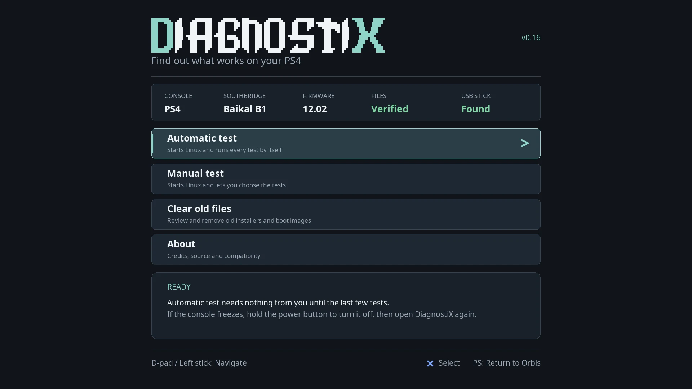
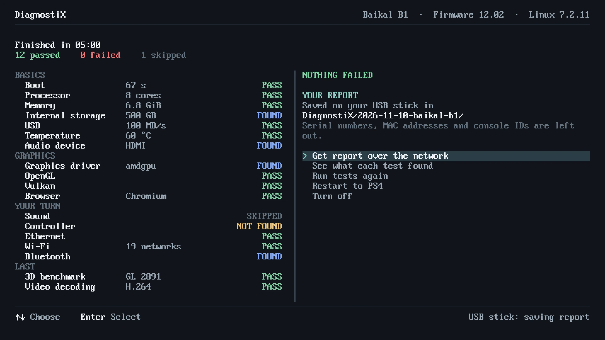

# DiagnostiX

DiagnostiX is a small Linux system for testing a PS4. It boots on the console, looks at the hardware, runs a set of checks and saves the results in a report you can read and share. It answers one question: what works on this console?

It's in beta. Every report helps, including one that says it didn't boot.

## What it looks at

| Area | What DiagnostiX does |
| --- | --- |
| Hardware overview | Shows the detected hardware and the results saved during this boot. |
| CPU and memory | Runs a short computation with a known answer, then writes and checks memory patterns. |
| Networking | Sets up Ethernet or Wi-Fi, shows the status and can run an HTTPS check. |
| Graphics | Draws OpenGL and Vulkan reference images and compares the pixels. |
| Browsers | Starts Firefox or Chromium for a graphics check. |
| Audio | Lists the audio devices and can play a short 44.1 kHz test sound. |
| Video decoding | Beta. Decodes an H.264 clip on the PS4's video hardware and compares the frames with a reference. |
| Power | Offers a confirmed Shutdown, or a Reboot that returns to the PS4 system. |

Checks run from the lowest layer up: CPU, then memory, then graphics, then browsers and video. A graphics test won't start until CPU and memory have passed on this boot. If a lower check fails, the ones above it are marked **Blocked** instead of failed, so one bad result doesn't look like five.

Graphics and browser tests start only when you choose them.

## Get it

The current public version is **alpha7**. It's a kit for people comfortable on a Linux computer, because it contains no firmware and has to be finished with files you supply yourself.

The alpha7 image has booted on the project's console. The public kit is a rebuilt, firmware-free copy of it, and a finished kit hasn't been booted yet, so your report would be the first.

You'll need:

- A PS4 Slim with a **Baikal** southbridge. The kernel is built for that console, and others are untested.
- A console that can already load a Linux payload, and a loader that suits its firmware. The recorded setup uses PS4 Linux Loader v25 with 1 GiB of video memory, which isn't a promise for other models or firmware.
- A USB drive formatted as FAT32.
- A Linux x86-64 computer with Python 3, `fakeroot`, `e2fsprogs` and a checkout of Linux psX at the matching revision.
- The firmware files named in the kit's `FIRMWARE-REQUIRED.json`, obtained yourself under their own terms. DiagnostiX doesn't include or download firmware.
- A USB keyboard, and an HDMI display. 1920×1080 at 60 Hz is the tested mode.

The steps are:

1. Download `diagnostix-alpha7-firmware-free-template03.tar.zst` from the [alpha7 release](https://github.com/meerzulee/linux-psx/releases/tag/diagnostix-alpha7-20261107) along with `SHA256SUMS`, then check it with `sha256sum -c --ignore-missing SHA256SUMS`.
2. Extract it to an ordinary folder and collect the firmware files in the paths the list gives.
3. Run the finalizer. It accepts only the listed file sizes and hashes, then builds a new boot set.
4. Copy the boot set to the USB drive with the stager, which checks the drive's identity first. It doesn't format or repartition.
5. Eject the drive safely, plug it into the PS4 and start it with your loader.

The exact commands are in the [alpha7 setup guide](https://github.com/meerzulee/linux-psx/blob/diagnostix-alpha7-20261107/docs/DIAGNOSTIX-RELEASE.md). The kit can't be booted or written to a drive until it has been finished, and a PC's boot menu can't start it.

## On the console

After network setup you land on **Overview**, which shows the detected hardware and any results from this boot. Missing data, untested checks, failures and inconclusive results are all shown separately.

Press **F7** for **Advanced**, the tabbed view with the individual tests. Picking a component on Overview opens its area without starting anything.

Reports are saved on the USB drive under `psx-diagnostics/results/`, so you can read them on a computer after a clean shutdown. [Results and Reports](07-results-and-reports.md) explains them.

SSH is optional. DiagnostiX ships with no shared key or password. You can [enroll your own key](../docs/PS4-DIAGNOSTIC-SSH-ACCESS.md) from the console.

## Before you run a test

- **If the console freezes,** hold the power button to turn it off, then start again.
- **Shutdown and Reboot are immediate.** Once confirmed, they can end running tests and discard unsaved results. Reboot goes back to the PS4 system, not into Linux again.

## Coming next: an app

A version that installs as a PS4 app is in development and isn't public yet. It runs from the console's memory, so it doesn't boot from a USB drive. Choose **Automatic test** and it runs the tests in order, needs nothing from you until the last few, and writes one report.

_Rendered on a development computer. The console uses its own system font._

When the run ends you get one page of results. The report is saved to a USB stick if one is plugged in, and you can fetch it over your own network from a QR code.

_Sample results, not a real console._

A full automatic run has passed on the project's own PS4 Slim with a Baikal B1 southbridge on firmware 12.02. This chapter will cover the app properly once there's a download.

<!-- manual-navigation -->

---

[← Previous](05-other-distributions.md) · [Contents](README.md) · [Next →](07-results-and-reports.md)
